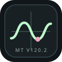

<p align="center"></p>

# Mitchell Tech V120.2

A self-teaching scientific and graphing calculator in a single HTML file.
Start with ordinary arithmetic, learn what each control does, and work up to
functions, graphs and introductory calculus. A local page ledger remembers
notes and recalls the source, inspired by the closed-page approach in MPLPB.

No installation, account, server, external libraries or Internet connection
is needed to run the calculator.

## Open it

1. Extract this ZIP.
2. Open the `mitchell-tech-v120.2` folder.
3. Open `index.html` in a modern browser.

Keep the ZIP or an extracted copy as your original project backup. The
calculator itself is entirely inside `index.html`; `logo.svg` illustrates
this README and is not required to run the app.

## Start learning

- Begin in **Standard** mode. Enter `7+5` and press **=** or Enter.
- Leave **Teaching on** to see control explanations, calculation steps and
  suggestions when an entry fails.
- Select **Explain a control**, then select a control to learn its purpose
  without activating it. Switch explanation mode off, or press Escape, to
  use controls normally.
- Open **Start learning** for 13 short lessons, worked examples and practice.
- Use **Resume lesson** to return to the most recently viewed lesson.
- Open **Functions A–Z** for definitions, input rules and examples.
- Select **Explain last answer** to review a calculation using its recorded
  inputs and angle mode.

## Calculator

Switch between **Standard** and **Scientific** keypads. You can type supported
scientific functions in either mode.

| Tool | Use |
| --- | --- |
| Standard | Addition, subtraction, multiplication, division and percentages |
| Scientific | Powers, roots, factorials, logarithms and trigonometry |
| RAD / DEG | Switch angle units for ordinary and inverse trig functions |
| `ans` | Reuse the last successful answer |
| MS / MR / MC | Store, recall or clear the one-number `mem` slot |
| History | Select a previous calculation to enter it again |

Examples: `sqrt(81)+2^3`, `log(1000)`, `5!`, `sin(pi/2)` in RAD mode.
Percent means division by 100: `20%` is `0.2`. For 20% off 80, enter
`80*(1-20%)`.

## Your calculator board, colors and touch display

**Settings** opens presets (Midnight, Paper, Ocean, Plum and High contrast),
custom background/panel/text/accent colors and a six-color curve palette.
Text size, key height, graph height, curve thickness and grid visibility are
adjustable. A text/background contrast readout helps compare custom colors.

- **Standard** provides the everyday number and operation keypad.
- **Scientific** adds visible buttons for every supported scientific function.
- **My board** keeps your chosen function keys beside the everyday keypad;
  select those functions in Settings.
- **Keys enter into** routes the graphical keypad to Calculator or a graph
  expression. Focusing an entry selects its target too.
- **Graph keys** opens a touch keyboard inside the graph frame, including in
  the expanded viewer. Choose the graph expression, tap its formula, and use
  the function menu to insert any supported function.

Touch targets, responsive layouts and pointer gestures are designed for iPad,
tablet and computer browsers. On touch devices the on-screen keypad inserts
text without deliberately reopening the system keyboard. Tapping a text
field still allows normal browser text entry. Actual iPad/browser visual
verification was not available in the build environment.

Display and custom-keypad settings are remembered with the workspace and
included in exported JSON backups. Reset display settings returns the original
appearance and default key selection without deleting saved work.

## Graph viewer

| Graph type | Expression example |
| --- | --- |
| Cartesian | `a*x+b` or `x^2-4` |
| Polar | `4*cos(5*t)` |
| Parametric | `3*cos(t); 2*sin(t)` |

Choose the graph type beside each expression. Use `a` and `b` as sliders.
Polar and parametric plots sample one full parameter turn in the selected
angle mode.

- Drag to pan; scroll or pinch to zoom.
- **Trace** follows the first visible Cartesian curve.
- **Table** lists sampled values of visible Cartesian functions.
- **f′** overlays approximate derivatives as dashed curves.
- **Fit y** adjusts the vertical view using most sampled values.
- **1:1** gives both axes equal screen scales.
- **Expand** opens a larger graph viewer; **Return** or Escape restores it.
- **Reset view** returns to the default viewing window.
- **PNG** exports a picture of the graph.

The numerical lab estimates values, slopes, roots, stationary points,
intersections and signed integrals of Cartesian functions. Choose a function,
operation and interval, then select **Analyze function**.

## Offline tutor

Try these commands:

```text
explain 2*(3+4)
solve x^2-5*x+6=0
differentiate sin(x)*x^2
integrate sin(x) from 0 to pi
plot a*cos(x)+b
recall square root
```

The tutor uses mathematical rules and local page retrieval. It is not a large
language model and does not generate or run arbitrary programs. Linear and
quadratic equations receive algebraic steps; other supported equations use a
numerical search over the visible x interval.

## Browser memory and local recall

Your workspace, calculator history, number memory, named notebooks, lesson
progress and recall pages use browser storage.

**Crawl & recall** builds an index from the built-in guide, lessons, current
workspace, calculation history, recent tutor/lab records, saved notebook
notes and your personal pages. It does not crawl websites.

- One clear page match: show that page with its source.
- Close competing matches: ask you to choose a page.
- No supported match: say **Not in these pages**.

Use **Add a page** for your own notes, or **Remember this explanation** to keep
a coaching explanation. Personal notes are recalled as written, not verified
as facts.

## Save and move your work

**Save** creates a named workspace snapshot. **Notebooks** opens saved
snapshots and provides JSON import/export.

A JSON export contains the current workspace, lesson progress and personal
recall pages/records. Named snapshots can be opened and exported individually.
A PNG is only a picture; a JSON backup restores editable work. Importing a
backup restores the included workspace and replaces learning/recall data when
those fields are present. Older version-1 backups remain supported.

Browser storage may be restricted for local HTML files and can be cleared by
browser settings. Renaming or moving a local file, switching browsers or using
private browsing can also change which storage is available. Export JSON
before moving the project or clearing browser data; the project ZIP does not
contain work you later save inside your browser.

## Keyboard

- Calculator: **Enter** evaluates.
- Tutor: **Ctrl/Command + Enter** submits.
- Focused graph: **arrow keys** pan, **+ / −** zoom, **Home** resets.
- **Escape** leaves explanation mode or the expanded viewer, and closes dialogs.

## Hosting

The folder can be served as a static site. For GitHub Pages, upload these files
to a repository and enable Pages for its root folder. No build step is needed.

## Numerical limits and validation

Plots and derivatives use sampling. Root searches can miss closely spaced or
irregular solutions. Integrals use a fixed Simpson rule and can miss
singularities. Numerical output is approximate; the graph plots real values.

The implementation passed 2,205 mathematical drills plus 104 engine/application checks, including
simulated session reopening and JSON restoration. The original published build was also smoke-tested in desktop Chrome. The patched build has not been deployed by this test run. See `TESTING.md` for findings, coverage and limits.

## Test and patch report

See `TESTING.md` for the live-browser findings, corrected defects and verification limits. Optional repeatable Node.js drills are in `tests/`. These files are not required to run the calculator.

## Files

- `index.html` — the complete calculator, graph viewer, teacher and local ledger (CSS and JavaScript formatted for editing)
- `README.md` — setup, usage and project reference
- `logo.svg` — project logo
- `LICENSE` — MIT license, matching the reference project's attribution
- `.gitignore` — common operating-system files excluded from Git

## License

MIT. See `LICENSE`.


## Reproducible benchmarks

For the latest **globally deduplicated** mathematical and offline-tutor drills, see [BENCHMARKS.md](BENCHMARKS.md). The extended Node.js runner is `node tests/unique-benchmarks.cjs`; it writes one result per distinct question to `tests/unique-benchmarks-results.json` and uses a fixed random seed. Following the 18 October 2026 corrections, **22,242 / 22,242** unique questions pass, with two repeated raw expressions skipped by the deduplication gate. The earlier 22,224 / 22,226 result is retained in the historical benchmark report. The calculator itself does not need Node.js to run.

## Development and source structure

The app deliberately remains a **standalone HTML file**: all CSS and JavaScript are inline so downloads work without a build step or dependencies. The former multi-thousand-character style and script lines have been formatted for review, and the calculator now appears before educational panels on desktop and mobile. See [DEVELOPING.md](DEVELOPING.md) for source navigation, build-free testing, state/persistence boundaries, and reproducible verification.

## Mr. E — expanded offline math coach

The built-in tutor is now **Mr. E**. He explains supported calculator functions, offers 20 math lessons (including calculator controls and Cartesian/polar/parametric graphing), guides practice with hints, gives sampled graph walkthroughs, and can explain a test record by ID after **Load benchmark JSON**. Example prompts: `teach fractions`, `what is atan2`, `explain graph x^2-4`, `practice powers`, and `explain test MT-000001` (after importing the test results JSON). See [MR-E.md](MR-E.md) for the supported curriculum, test import procedure, limits, and suggested questions. Mr. E is rule-based and completely offline, **not an embedded LLM**.

Tutor update verification on 18 October 2026: **69/69 distinct Mr. E prompt checks**, **2,205/2,205 legacy math checks using the original non-deduplicated fixed-case harness**, **104/104 application checks**, and **29/29 local Chromium UI/tutor checks**. These are separate suites; they should not be summed into a new unique total. See [MR-E.md](MR-E.md).

## Clear calculations and graphs

- **Clear History** appears just above recent calculator results when history exists. It clears the stored calculation history, but **keeps** the last answer (`ans`), one-number memory (`mem`), saved notebooks, and graph expressions.
- **Clear All Graphs** is beside **Add an expression** in the Expressions panel. It removes all plotted expression rules at once; saved notebooks, calculator history, memory, and the current graph view remain intact. The control disables itself when there are no graphs. You can add a new graph immediately.

Both actions autosave the updated workspace in browser-local storage. They do **not** erase exported backups or separate saved notebook snapshots. Use `node tests/clear-controls.cjs` to rerun the selective-clear regression tests.
